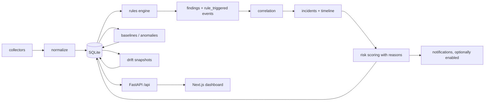

# Architecture

Sentinel monitors **one Linux server**. It collects evidence, normalises it, applies user-defined
rules, groups related events into incidents, learns simple behaviour baselines, detects configuration
drift, scores risk with transparent arithmetic, and presents everything in a Next.js dashboard.
It never remediates: no blocking, killing, permission changes or config edits on the monitored host.

## Layers

| Layer | Responsibility | Reads / writes |
|---|---|---|
| `core/` | Pure logic: event schema, conditions, rules, correlation, scoring, baselines, drift, export. No DB, clock, filesystem or network. | Takes data, returns results |
| `collectors/` | The only modules reading system state (logs, processes, network, files). | Reads monitored state; returns events |
| `storage/` | The only modules with SQL. WAL SQLite, migrations, keyset pagination, idempotent upserts. | Own DB only |
| `engine/` | Orchestration: ingest → rules → baselines → correlation → scoring → notify → publish. | DB, notification channels |
| `api/` | Thin FastAPI handlers: validate → call core/storage → serialise. Typed errors and OpenAPI contract. | DB via storage |
| `web/` | Next.js dashboard. Renders API output; edits config through the typed client. No security logic. | Browser cookies only |

## Data flow

Each engine step is isolated: a failure is reported but does not stop later steps. Running a cycle
twice does not duplicate events, findings, incidents or notifications because storage uses unique
keys and the collectors keep their own state.

## Timestamps and identity

Stored timestamps are UTC ISO-8601 (`+00:00`). An event's hash is SHA-256 of canonical JSON
**excluding** `severity`, `severity_source` and `enrichment`, so editing severities never duplicates
events. Event ids and incident ids are integers; rule ids are lowercase slugs.

## Determinism

Rule evaluation, correlation and scoring are independent of input order. A component's identity is
its earliest anchor event hash. Baselines use simple statistics (mean and standard deviation), not
machine learning. MITRE mappings are static and indicative.

## Boundaries

The API binds to `127.0.0.1` by default and refuses non-loopback binds without an explicit remote
setting. The Next server proxies `/api/*` to it, so the browser uses same-origin cookies and no
CORS. Secrets live only in environment variables; the DB stores their names. Monitored file
contents, command lines, SSH private keys and `/etc/shadow` contents are never stored.
